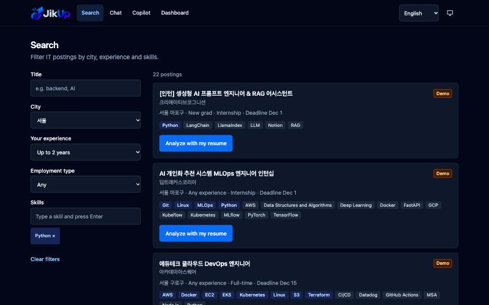
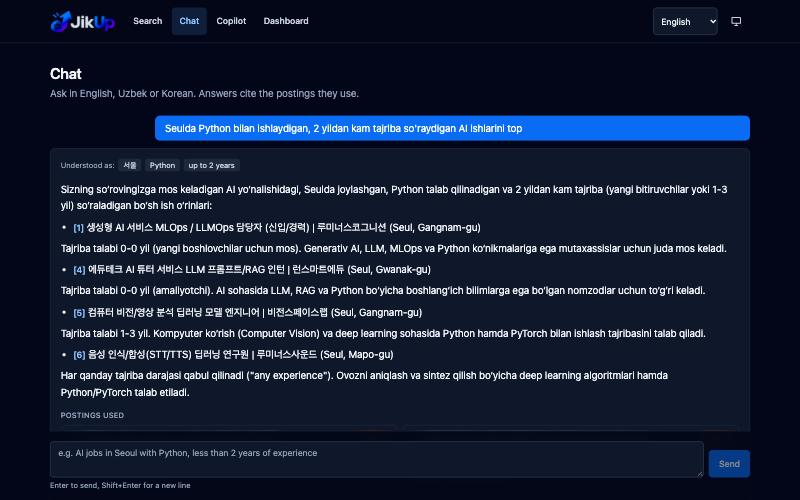
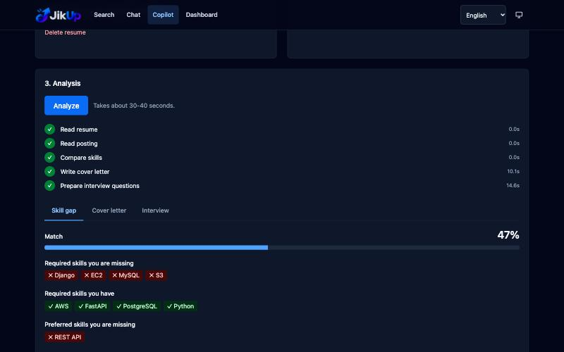
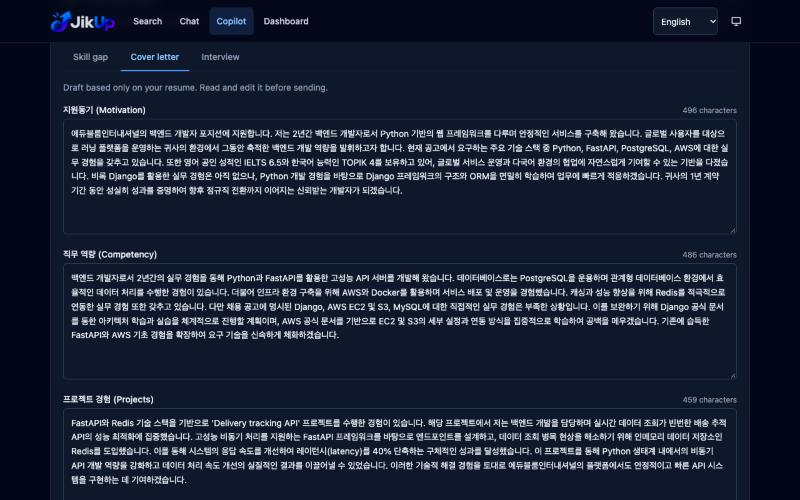
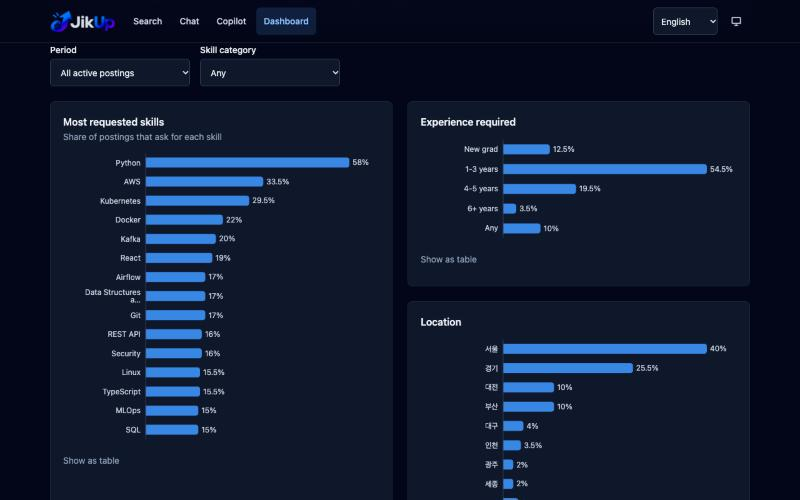

# JikUp

JikUp helps developers find IT jobs in Korea and prepare the application: ask for jobs in English, Uzbek or Korean, compare your resume with a posting, and get a Korean cover letter (자기소개서) and interview questions.

Non-commercial portfolio project. **All 200 postings in this repository are synthetic demo data with fictional companies.** The Saramin collector is built but waits for an API key.

| Search | Chat (Uzbek question, cited answer) |
|---|---|
|  |  |
| **Copilot: skill gap** | **Copilot: 자기소개서 draft** |
|  |  |



## What it does

- **Search** postings by city, experience, employment type and skills. Korean and English skill names both work (`파이썬` finds Python).
- **Chat**: a question in any of three languages becomes filters plus a Korean search query. Hybrid retrieval finds postings and the answer streams back in the question's language, citing each posting.
- **Copilot**: upload a PDF resume and pick a posting. A tool-calling agent compares skills (deterministic), writes a four-section 자기소개서 and prepares interview questions. Every step streams to a timeline.
- **Dashboard**: most requested skills, experience and city distribution, weekly trend, skills requested together, and how your resume compares with the market.
- UI in English, Uzbek and Korean, dark mode, keyboard and screen-reader support.

## Run it

Requires Docker with Compose v2 and `make`.

```bash
cp .env.example .env
make demo
```

Open http://localhost:8080. On a clean machine this took 101 seconds: it builds the images, runs migrations, and loads and indexes the 200 demo postings.

Search and Dashboard work as is. Chat, Copilot and semantic search need a Gemini API key: put it in `.env` as `GEMINI_API_KEY`, then run `make demo` again.

| Command | What it does |
|---|---|
| `make demo` | Production-style build at http://localhost:8080 (nginx, CSP) |
| `make up` | Development stack with hot reload at http://localhost:5173 |
| `make seed` | Load and index the demo postings again |
| `make test` / `make lint` | Backend and frontend tests / linters and type checks |
| `make down` | Stop everything; data is kept |

## Architecture

```
 Browser (React + TypeScript)
    │  /api, Server-Sent Events
    ▼
 nginx ── static build, CSP, /api proxy without buffering
    │
    ▼
 FastAPI ──────────────► Gemini
  │  search, chat, agent,      Flash: chat, agent, cover letter
  │  resumes, analytics        Flash-Lite: query parsing
  │  rate limits (Redis)       Embedding 001: 1536-dim vectors
  │
  ├──► PostgreSQL 16 + pgvector (HNSW) + full-text tsvector
  └──► Redis ◄── arq worker
                  collect (Saramin every 6 h, seed)
                  chunk + embed new postings
                  delete resumes after 7 days
```

**Stack:** FastAPI, SQLAlchemy 2 (async), Alembic, Pydantic v2, arq, PostgreSQL 16 with pgvector, kiwipiepy, google-genai, React 19, TypeScript, Vite, Tailwind CSS 4, TanStack Query, Recharts, Docker Compose, GitHub Actions.

## Technical decisions

- **Hybrid retrieval with Reciprocal Rank Fusion.** Each query runs SQL filters, a pgvector cosine search and a keyword search over Korean tokens. The two rankings are merged with RRF (k = 60) and grouped per posting. Skills in a query are expanded to every spelling in the dictionary, so `Python` also matches `파이썬`. If fewer strict matches exist than requested, the list is filled without the skill filter and marked as close matches. If nothing matches, filters are relaxed one by one and the answer says which.
- **Korean tokenization.** Korean attaches particles to words (`파이썬을`). kiwipiepy extracts nouns, with IT terms registered so `백엔드` and `머신러닝` stay whole; Latin terms such as `k8s` and `C++` are matched separately.
- **Section-aware chunking.** Postings are split into 주요업무 / 자격요건 / 우대사항 / 복지 by general heading rules (Korean, English, numbered and bracketed forms), and each chunk carries a company, title and location prefix. Skills under 자격요건 count as required.
- **Deterministic where possible, LLM where needed.** The skill-gap score is plain arithmetic (required skills weigh 2, preferred 1). The LLM only writes text. The agent's tools are bound to one resume and one posting on the server, so a prompt can never make it read someone else's data, and missing outputs fall back to direct tool calls.
- **Measured before optimizing.** The plan suggested a materialized view for analytics. Every analytics endpoint answers in 3 to 7 ms on this data, so it uses plain SQL with 5-minute cache headers. The weekly trend only shows complete weeks.
- **Reasoning effort.** Gemini's default thinking delayed the first chat token by about 10 seconds. With `thinking_level=LOW` it arrives in about 3 to 4 seconds (search and parsing included).

## Quality

20 evaluation queries (7 Uzbek, 9 English, 4 Korean) in `backend/eval/rag_queries.yaml`. Relevant postings are defined by explicit rules over the database, so the labels are transparent and reproducible. Run with `uv run python -m eval.run_eval`.

| | Recall@10 | Precision@10 | Hit@1 | Filter accuracy |
|---|---|---|---|---|
| Baseline (day 3) | 0.932 | 0.795 | 1.00 | 0.95 |
| After fixes (day 6, original rules) | **0.967** | 0.770 | 1.00 | **1.00** |

Precision dropped because short result lists are now filled to 10 with close matches: a query with 4 relevant postings can reach at most 0.4. One relevance rule (Daejeon AI roles) was later changed to follow AI/ML skills instead of title words; results for both rule sets are in `backend/eval/results/`. The data is synthetic and generated per role, so expect lower numbers on real postings.

**Tests:** 212 backend tests (91% line coverage, including database tests on pgvector) and 21 frontend tests. CI runs linting, type checks, migrations up and down, tests with a 60% coverage gate, and builds both Docker images.

## Security and privacy

- Resumes and agent runs use unguessable UUIDs, are deleted automatically after 7 days, and can be deleted at once from the UI. The applicant's name is never sent to the model, and resume text is never logged.
- PDF uploads are checked by content (magic bytes), size, page count and encryption before parsing.
- Per-IP rate limits in Redis: agent 5 per hour, resume upload 10 per hour, chat and search 20 per minute, everything else 120 per minute.
- Strict Content-Security-Policy and security headers; the admin endpoints need a token compared in constant time.
- API keys stay on the server. Pre-commit runs a secret scan (gitleaks), and the git history has been scanned clean.

## Limitations

- **Synthetic data.** All postings are generated demo data, so the dashboard numbers and especially the weekly trend do not describe the real market.
- **Saramin not verified.** The collector follows Saramin's documented format but has not seen a real response yet, and the public API may not return full description text.
- **Generated text needs review.** The cover letter prompt forbids invented facts, but the model still sometimes adds technical details that are not in the resume. The UI asks users to read and edit the draft.
- **Korean UI strings** were written without a native-speaker review.
- **Deployment.** Behind a reverse proxy, every request appears to come from the proxy's IP, so the rate limiter needs the real client IP forwarded before going public. Set `ENV=production` to turn off the API docs.

## Image credits

The landing page backgrounds in `frontend/src/assets/landing/` (`palace.webp`, `skyline.webp`) are cropped, tinted and (for the skyline) mirrored versions of photos from Wikimedia Commons. The adapted images are shared under the same license, [CC BY-SA 4.0](https://creativecommons.org/licenses/by-sa/4.0/):

- [Front view of the Imperial Throne Hall Geunjeongjeon at Gyeongbokgung Palace](https://commons.wikimedia.org/wiki/File:Front_view_of_the_Imperial_Throne_Hall_Geunjeongjeon_at_Gyeongbokgung_Palace_with_blue_sky_in_Seoul.jpg) by Basile Morin
- [Lotte World Tower and Namsan Tower in Seoul](https://commons.wikimedia.org/wiki/File:Lotte_World_Tower_and_Namsan_Tower_in_Seoul.jpg) by Arturbraun

## License

No license yet: all rights reserved until one is added.
